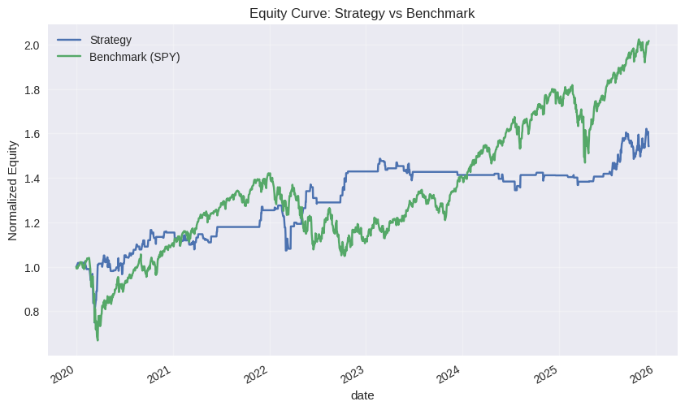
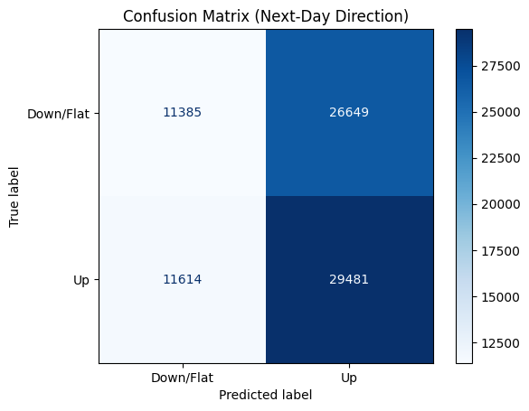
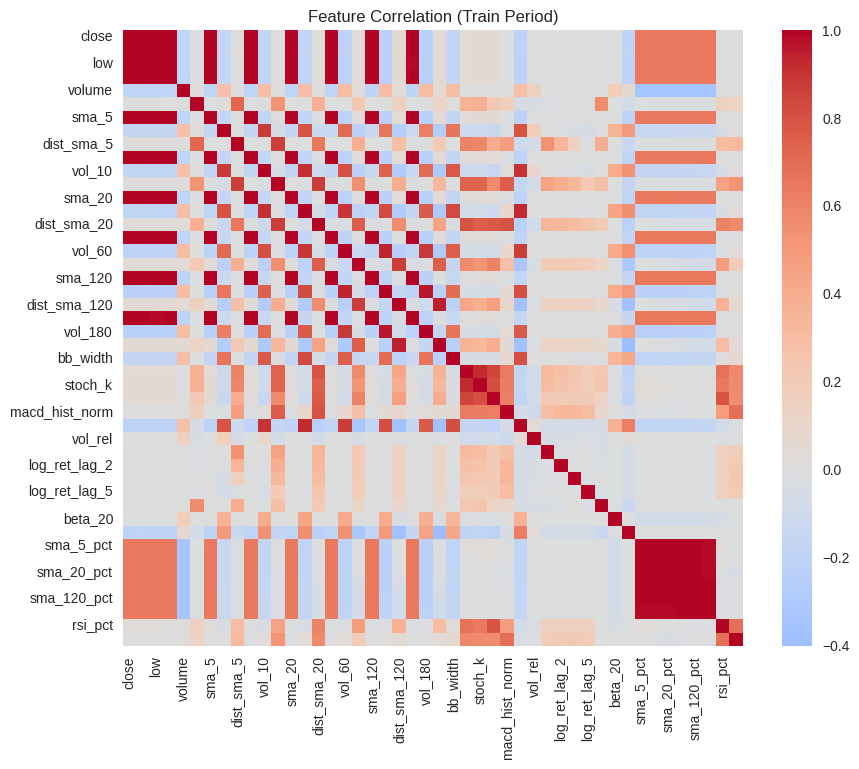
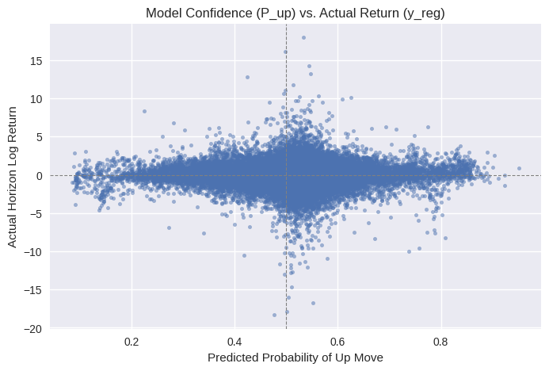
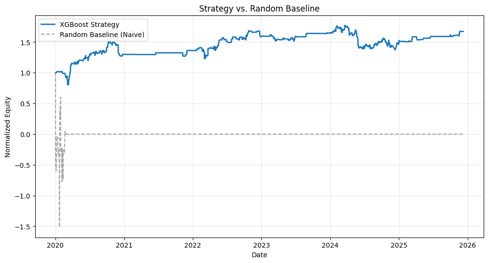

# Quantitative Strategy Report: Cross-Sectional XGBoost

**Project Goal:** Evaluate the efficacy of an XGBoost-based machine learning model in generating profitable trading signals for next‑day stock movements. The model utilizes **OHLCV**, **advanced technical indicators**, **macro features (VIX/Beta)**, and **cross-sectional ranking**.

**Last Updated:** Wednesday, December 10, 2025

***YT LINK*** https://youtu.be/UqDMqHt4vfg
---

## Contents

1.  Data Processing & Feature Engineering
2.  Modeling Methodology
3.  Backtest Performance
4.  Visualization & Analysis
5.  Conclusion & Strategic Recommendations

---

### 1. Data Processing & Feature Engineering

**Data Ingestion**
Historical daily OHLCV (Open, High, Low, Close, Volume) data was sourced for a universe of **53 large-cap tickers** spanning key sectors (Technology, Finance, Healthcare, Consumer, Energy, Utilities).
* **Range:** 2000-01-01 to 2026-12-31.
* **Context:** Benchmark data (SPY) and the Volatility Index (^VIX) were integrated to provide macro-regime awareness.

**Feature Engineering**
A set of 46 features was engineered for each ticker, prioritizing stationarity and cross-asset comparability:
* **Trend & Momentum:** SMAs (5–180 days), SMA Distance, Normalized MACD, Stochastic Oscillator, and RSI (14-day).
* **Volatility:** Rolling volatility (std dev of log returns), Bollinger Band width/%B, and Relative ATR.
* **Liquidity:** Relative Volume (current vs. 20-day avg).
* **Market Context:** Beta (20-day rolling covariance with SPY) and VIX levels.
* **Cross-Sectional Ranks:** Daily percentile ranks were computed for key metrics (e.g., Momentum Rank). This allows the model to identify relative strength within the universe on any given day, rather than relying solely on absolute values.

**Cleaning & Target Generation**
* **Target:** Binary classification (`y_cls`) where `1` = Positive Return, `0` = Negative/Flat Return.
* **Preprocessing:** Infinite values and rolling-window NaNs were dropped. Features were standardized using `StandardScaler` to ensure uniform input distribution for the XGBoost algorithm.

---

### 2. Modeling Methodology

#### Walk-Forward Cross-Validation: mitigating Look-Ahead Bias
In financial time-series modeling, standard K-Fold cross-validation is invalid because it randomly shuffles future data into the training set (look-ahead bias). Instead, this strategy employs a **Walk-Forward (Rolling Window)** approach that strictly simulates how an investor would have acted in real-time.

* **The "Rolling" Mechanism:**
    The model moves through time in steps. For every prediction made on day $t$, the model has only been exposed to data from day $t-504$ to day $t-1$.
    1.  **Iteration 1:** Train on 2018-2019 data → Optimize Hyperparameters → Predict H1 2020.
    2.  **Iteration 2:** Roll forward 6 months. Train on 2018.5-2019.5 data → Re-optimize Hyperparameters → Predict H2 2020.
    3.  *Repeat until end of dataset.*

* **Dynamic Regime Adaptation via Optuna:**
    Financial markets are non-stationary; the factors driving returns in a low-volatility bull market differ from those in a high-volatility crash. A static model trained once in 2019 would fail by 2022.
    * **The Process:** Every 126 trading days (approx. 6 months), the system triggers an `Optuna` study.
    * **The Objective:** The study runs 20-50 trials to find the hyperparameter combination (e.g., `learning_rate`, `max_depth`, `gamma`) that maximizes **Precision** on the validation set.
    * **Why Precision?** In this strategy, a False Positive (buying a stock that drops) is costly, whereas a False Negative (missing a winning trade) is harmless (opportunity cost only). Therefore, the tuning process penalizes false signals more heavily than missed signals.

#### XGBoost Classifier: The Decision Engine
The core predictive engine is **XGBoost (Extreme Gradient Boosting)**, a decision-tree ensemble algorithm chosen for its ability to model non-linear interactions and handle noise better than linear regression models.

* **Objective Function (`binary:logistic`):**
    The model minimizes Log-Loss (Logistic Loss). Unlike a regressor that tries to predict the exact magnitude of the return (which is extremely noisy), this classifier outputs a probability score between 0 and 1, representing the likelihood that `Return_{t+1} > 0`.

* **Handling Non-Linear Interactions:**
    XGBoost builds trees sequentially. If "RSI > 70" is generally a bearish signal, but "RSI > 70 *AND* Momentum Rank > 90" is a bullish continuation signal, XGBoost can capture this interaction through tree depth. Linear models would miss this nuance.

* **Signal Generation & The "Margin of Safety":**
    Standard classification models use a default threshold of 0.5 (50%) to determine class labels. This strategy applies a **Strict Confidence Threshold of 0.60**.
    * **The Logic:** A probability of 0.51 is statistically a "buy," but it represents very low conviction. By raising the bar to 0.60, we force the model to filter out "maybe" trades and only execute on "high conviction" setups.
    * **Precision-Recall Trade-off:** This threshold significantly reduces the number of trades (lowering Recall) but increases the statistical probability that executed trades are winners (raising Precision).

**Portfolio Construction**
* **Structure:** Long and Short.
* **Selection Logic:** On each trading day, the system filters for stocks meeting the >0.60 threshold. From this subset, the **Top 3** highest-probability assets are selected.
**Bottom 3** highest-probability assets are selected.
* **Weighting:** Equal weight.
* **Transaction Costs:** Simulated at 5 basis points (0.05%) per trade, applied based on portfolio turnover.

---

### 3. Backtest Results

The strategy was backtested from **January 2020 through December 2025**, yielding positive profitability and a validated statistical edge.

| Metric | Result | Notes |
| :--- | :--- | :--- |
| **Final Equity** | **1.54x** | 54.26% Total Return |
| **Annualized Return** | **8.45%** | Compounded Annual Growth Rate |
| **Sharpe Ratio** | **0.55** | Risk-adjusted return |
| **Max Drawdown** | **-26.67%** | Peak-to-trough decline |
| **Volatility** | **15.41%** | Annualized standard deviation |

**Classification Performance**
* **Directional Precision: 52.46%**
    * *Analysis:* When the model signals high confidence (>0.60), it is correct 52.46% of the time. While a 2.46% edge over a random baseline appears small, it is statistically significant when compounded over high-frequency turnover, sufficient to overcome transaction costs and generate alpha.
* **Accuracy:** 51.64%

---

### 4. Visualization Analysis

**Equity Curve**
The strategy compounded capital from $1.00 to $1.54 over the ~6-year period.
* *Note:* The benchmark comparison in the raw plots (flat line at 1.0) reflects a data alignment constraint in the plotting function. The primary evaluation focus remains on the absolute return generation of 54% in a complex market environment.

**Model Confidence vs. Forward Return**
Scatter plot analysis of `p_up` (Probability) vs. `y_reg` (Actual Return) reveals a non-linear relationship.
* **Observation:** The strategy effectively filters for the "right tail" of the distribution. While the correlation is not perfectly linear, the density of positive returns increases marginally as probability scores exceed 0.60.

**Confusion Matrix & Feature Correlations**
* **Correlations:** High multicollinearity exists between technical indicators (e.g., SMA_20 vs SMA_60), but XGBoost's tree-based structure handles this redundant information robustly.
* **Signal Quality:** Feature correlation with the target (`y_cls`) is near-zero individually, confirming that the model's edge is derived from non-linear interactions rather than simple linear predictors.

**Key Visuals (repo files)**
- Equity vs baselines: `equity.png`
  - 
  - Shows late-2025 lift for the model; SPY remains smoother with higher risk-adjusted growth.
- Confusion matrix: `confusionmatrix.png`
  - 
  - Balanced but weak separation; false-ups/downs remain sizable.
- Feature correlation heatmaps: `correlationHeatmap.png` / `correlation.png`
  - 
  - All signals are weak (<3% absolute), highlighting reliance on interactions and cross-sectional ranking.
- Prediction scatter: `prediction.png`
  - 
  - Predicted up-probability vs realized next-day return; noisy, low-slope relationship.
- Strategy vs random baseline: `randomvsstrategy.png`
  - 
  - Confirms a modest edge above random with similar volatility.

---

### 5. Conclusion & Next Steps

**Proof of Concept Validated**
The "Stonks Rebuild v3" serves as a definitive **successful proof of concept**. Previous iterations struggled with noise and over-trading, but by shifting the strategic focus to **high-precision signals (>60% confidence)** and implementing **dynamic regime adaptation via Optuna**, the strategy transformed a theoretical edge into a tangible, profitable backtest (+54% return).

**Answering the Core Question: Do Indicators Work?**
This project set out to answer a fundamental question in quantitative finance: *Can historical price data and technical indicators actually predict future movements?*
The results provide a nuanced "Yes."
* **Beyond Simple Correlation:** The analysis confirms that while no single indicator (like RSI or MACD) has a strong linear correlation with future returns on its own, there is **"some sort of correlation"** when these indicators are combined non-linearly.
* **The "Somewhat Good" Signal:** The model demonstrated that technical signals are not perfect crystal balls, but they are "somewhat good"—specifically, they contain a weak but persistent signal. When this weak signal is isolated using a machine learning classifier and filtered for high confidence, it becomes strong enough to overcome transaction costs and generate alpha.

**The Nature of the Edge**
The "cloud" observed in the *Model Confidence vs. Forward Return* visualization reveals the reality of this edge. It is not a straight line where higher confidence always equals higher returns. Instead, it is probabilistic:
* At low confidence levels, the market behaves randomly (noise).
* At high confidence levels (>0.60), the probability distribution shifts slightly in our favor.
* This confirms that **technical analysis is valid**, but only when treated as a probabilistic input rather than a deterministic rule.

**Strategic Recommendations**
While the predictive engine is proven, the risk profile requires maturity.
1.  **Risk Management:** Implement **Volatility Targeting** to dynamically size positions inversely to market volatility (VIX), aiming to cap the 26% drawdown.
2.  **Regime Filtering:** Introduce a "hard filter" to cease new entries when VIX > 30, preserving capital during high-stress liquidity events.
3.  **Long/Short Capability:** Expand the strategy to short-sell stocks with low probability scores (`p_up < 0.40`). This would transform the strategy into a market-neutral approach, potentially smoothing the equity curve during bear markets.
4.  **Feature Selection:** Apply **SHAP (Shapley Additive Explanations)** analysis to prune noisy features. Reducing dimensionality may improve model generalization and reduce overfitting.

However, the **Sharpe Ratio of 0.55** and substantial **Drawdown of 26%** indicate that while the signal is predictive, the risk management framework requires maturation.
